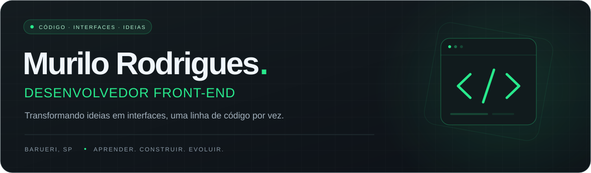
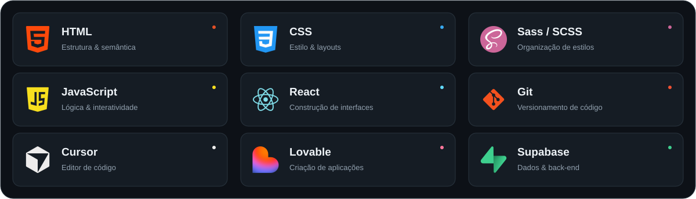
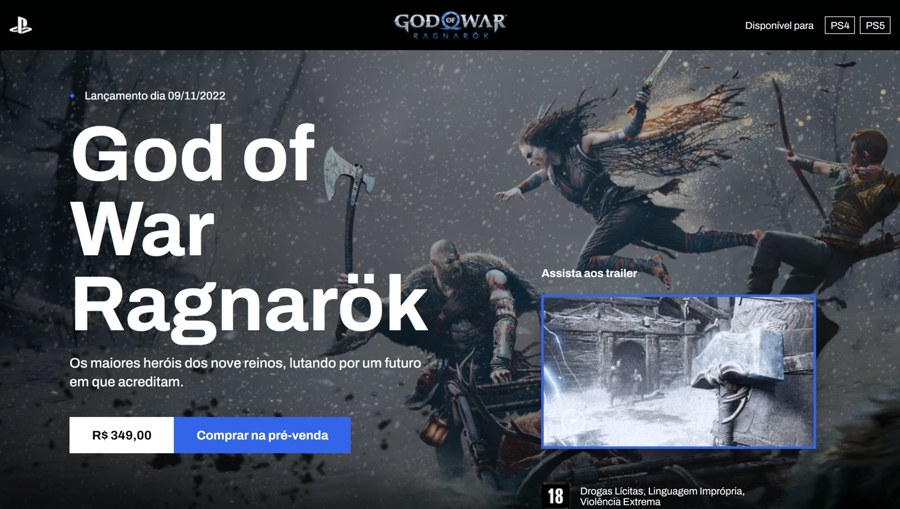
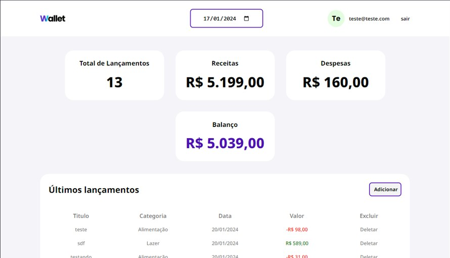
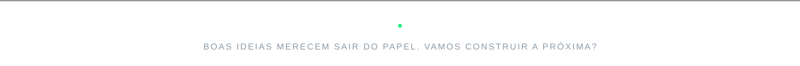

  

  
   
  
   
  

<h1 align="center">Olá, eu sou o Murilo 👋</h1>

  Gosto de transformar ideias em interfaces e encontrar soluções práticas com código. 
  Meu próximo projeto também é uma oportunidade de aprender algo novo.

Um pouco sobre mim

Sou Murilo Rodrigues, desenvolvedor front-end de Barueri, São Paulo. Minha jornada começou com HTML, CSS e Sass, recriando interfaces e colocando o que estudava em prática.

Hoje, sigo aprofundando meus conhecimentos em JavaScript e React, explorando ferramentas como Cursor, Lovable e Supabase e construindo projetos para transformar aprendizado em experiência.

Meu foco: desenvolvimento front-end, sites e interfaces de aplicações.
O que me motiva: resolver problemas e ver uma ideia funcionando na tela.
O que busco: oportunidades para contribuir, colaborar e crescer como desenvolvedor.

Tecnologias & ferramentas

  

Front-end: HTML · CSS · Sass / SCSS · JavaScript · React  
Versionamento: Git  
Ferramentas & plataforma: Cursor · Lovable · Supabase

Projetos que saíram do papel

Uma seleção dos projetos em que coloco meus estudos em prática, de landing pages a interfaces para o dia a dia.

<table>
  <tr>
    <td width="50%" valign="top">
      
      <h3>God of War</h3>
      
Landing page de estudo inspirada no universo do jogo, com foco em composição visual e desenvolvimento de interfaces.

      
<a href="https://murll0.github.io/God_of_War/"><strong>Explorar projeto →</strong></a>

    </td>
    <td width="50%" valign="top">
      
      <h3>Finances App</h3>
      
Projeto de controle financeiro para explorar uma aplicação voltada a uma necessidade prática do dia a dia.

      
<a href="https://murll0.github.io/finances_app/"><strong>Explorar projeto →</strong></a>

    </td>
  </tr>
</table>

Mais projetos	O que você vai encontrar	Acesse
Moklearn	Um projeto de interface web desenvolvido a partir de estudos de layout.	Ver projeto ↗
Finance	Uma página de temática financeira para praticar estrutura e estilo.	Ver projeto ↗
Barber Shop	Um site de barbearia com identidade visual própria do segmento.	Ver projeto ↗
	

  <a href="https://murll0.github.io/Site-Portifolio/"><strong>Conheça meu portfólio completo →</strong></a>
    ·  
  <a href="https://github.com/MURlL0?tab=repositories">Explore meus repositórios ↗</a>

O próximo passo

Quero continuar evoluindo na criação de interfaces, aprofundar JavaScript e React e explorar como conectar o front-end a dados e serviços. Cada projeto é uma chance de escrever código mais claro e entender melhor as ferramentas que uso.

Vamos trocar uma ideia?

Tem um projeto, uma oportunidade ou uma ideia para construir em conjunto? Vamos conversar.

LinkedIn   ·   Portfólio   ·   muriilorodrigues@outlook.com

  

